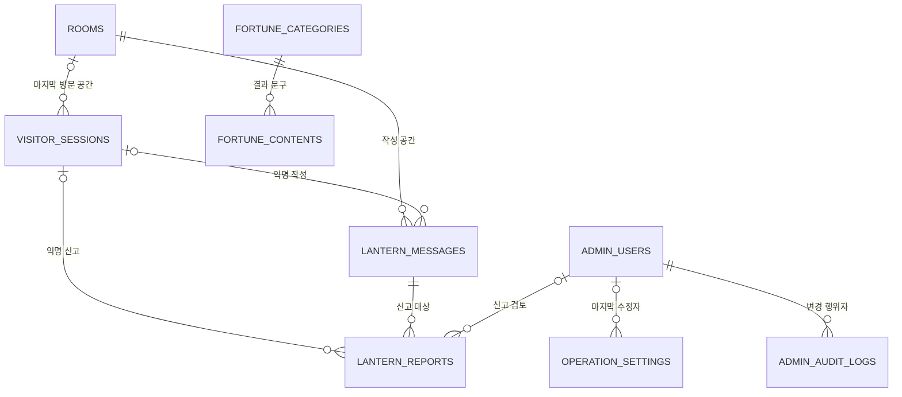

# NARU 아키텍처

## 확정 및 현재 구현

| 분류 | 영역 | 저장소 상태 |
| --- | --- | --- |
| 이미 구현 완료 | 기본 통합 | Vite 프록시를 통해 Spring Boot Health API에 도달한다. 기본 Compose에서 프론트엔드·백엔드가 healthy이며 직접·프록시 API는 HTTP 200으로 이전 실행에서 확인했다. |
| 이미 구현 완료 | 후원 UI | 꽃잎 버튼과 빈 QR 영역, 닫기 동작을 추가했다. 결제·송금 및 후원 권한 상태를 만들지 않는다. |
| 일부 구현 | 3D 월드 | `PlazaScene.tsx`에 절차적으로 만든 돌광장, 벚꽃나무, 누각, 달·별·등불·풍등과 OrbitControls가 있다. 벚꽃잎 파티클, 교체용 GLB, 세로 카메라 실기기 검증이 남아 있다. |
| 일부 구현 | 풍등 | 익명 식별, 200자 검증, 최신순 다른 이용자 목록, 서버 성공 후 2초 연출과 제거가 있다. 현재 목록은 8초 폴링이다. |
| 일부 구현 | 풍등 저장 | `wish-persistence` 개발 프로필로 MySQL에 저장한다. 기본 프로필에는 임시 메모리 저장을 유지한다. 목록은 커서로 30건씩 조회한다. WebSocket은 후속 작업이다. |
| 일부 구현 | 운세 | 프론트에서 일반 문구 8개 중 하나를 보여준다. 8개 카테고리와 검수용 문구 데이터, 카테고리별 결과가 필요하다. |
| 이미 구현 완료 | MySQL 개발 연결 | 별도 Compose 프로젝트에서 MySQL과 Spring JDBC의 실제 `SELECT 1`을 확인했다. 기능 스키마와 마이그레이션은 Phase 2 대상이다. |
| 일부 구현 | CI | PR과 `main` 업데이트를 대상으로 프론트엔드 검사와 백엔드 빌드·테스트 워크플로를 구성했다. GitHub 러너 실행 확인은 첫 PR에서 진행한다. |
| 아직 구현하지 않음 | 실시간·운영 | WebSocket, 정원과 공간 배정, 재접속, 대기열, 관리자 API·인증·감사, 신고·숨김, 부하 확인이 남아 있다. |
| 삭제·수정 검토 필요 | 전환 코드 | 현재 금지된 물·종이배·다리 구현은 소스에서 확인되지 않았다. 영속 저장과 실시간 API를 검증한 뒤 메모리 저장과 폴링의 대체 범위를 결정한다. |

프론트엔드는 Node 24·npm 11, React 19.2, TypeScript 5.9, Vite 8.3.5, Three.js 0.181, Fiber 9.4, Drei 10.7을 사용한다. 백엔드는 Java 17, Spring Boot 3.5.16, Gradle Wrapper 8.14.7, Spring MVC·Security·JDBC와 MySQL Connector/J를 사용한다. `compose.yaml`과 두 서비스 Dockerfile은 기본 통합, `compose.mysql.yaml`은 선택형 DB를 담당한다.

## 권장 구성

- `frontend/src/scenes/`는 월드·카메라·연출을, `features/`는 UI를, `services/`는 네트워크 경계를 맡는다. `public/models/`는 팀에서 검수한 3D 에셋 경로다.
- 백엔드에서는 컨트롤러, 서비스, 저장소 책임을 분리한다. 풍등 REST 등록은 트랜잭션 커밋 뒤 성공 응답과 이벤트를 보낸다. 클라이언트에서는 목록을 식별자로 합치고, 작성 성공 시 표시되는 풍등 오브젝트의 수명과 메시지 수명을 분리한다.
- 페이지 순서는 생성 시간·식별자로 안정적으로 정한다. 재연결과 페이지 조회가 겹칠 때 목록 중복 제거와 누락 복구를 검증한다.
- 방 배정과 슬롯 예약은 단일 인스턴스에서 원자적으로 처리한다. 26명 자동 개설, 30명 상한, 운영 상한, 대기열을 동일한 상태 전이에서 검증한다.
- 관리자 API·권한 모델·2단계 인증·감사 동작을 코드보다 먼저 문서화한다. 공개 익명 입력은 검증, 악용 대응과 신고·숨김을 같이 고려한다.

## 미확정 인터페이스

WebSocket 주소와 이벤트 스키마, 재연결 토큰 수명, 신고 처리, 이용자 식별·보관 정책, 운영 접근 제어는 팀 검토 후 확정한다. 초기 단일 서버를 기준으로 설계하되 다중 인스턴스 동작은 별도 검증 대상으로 둔다.

## 초기 ERD v1.0

사용자가 제공한 MySQL 스키마 v1.0 기준이다. 현재 저장소의 실행 스키마는 아니며, 이 문서에 정리하는 과정에서 DDL이나 시드 SQL을 실행하지 않았다. 개발 Compose는 MySQL 8.4를 사용한다.

| 테이블 | 주요 컬럼과 책임 |
| --- | --- |
| `admin_users` | 고유 사용자명, 비밀번호 해시, 암호화한 TOTP 비밀값, 권한과 계정 상태 |
| `rooms` | 고유 공간 번호 1~10과 안정적인 공간 식별자. 정원·접속 여부는 런타임에서 관리 |
| `visitor_sessions` | 고유 세션 토큰 해시, 선택적인 마지막 공간, 최근 활동 및 만료 시각 |
| `lantern_messages` | 필수 공간, 선택적 세션, 표시명, 최대 200자 본문, 공개 상태, 생성·선택적 만료 시각 |
| `lantern_reports` | 필수 대상 메시지, 선택적 신고자 세션과 검토 관리자, 신고 사유와 처리 상태 |
| `fortune_categories` | 고유 카테고리 코드, 이름, 정렬 순서와 활성 상태 |
| `fortune_contents` | 필수 카테고리, 사전 작성 결과 문구와 활성 상태 |
| `operation_settings` | 단일 설정 행. 기본 최대 공간 2개, 정원 30명, 개설 기준 26명, 입장·자동 개설 제어 |
| `admin_audit_logs` | 필수 관리자, 작업과 대상, 변경 메타데이터. 비밀값과 원문 메시지는 기록 대상에서 제외 |

초기 데이터는 공간 식별자 10개, 운영 설정 1행, 운세 카테고리 8개다. 등록된 공간 식별자와 현재 개설된 공간은 별도로 관리한다. 접속자 수, 이동 위치, 대기열과 풍등 애니메이션은 DB에 저장하지 않는다.

### 구현 전 검토

- **메시지 길이와 익명 세션**. 화면과 API는 200자 기준을 공유한다. 현재는 브라우저가 만든 작성자 키의 해시를 저장하며 서버 발급 세션 토큰은 후속 계약 검토 대상이다. 공개 응답에는 세션 토큰과 해시를 포함하지 않는다.
- **공간 배정 선행 조건**. 소원 등록은 필수 `room_id`가 필요하다. 전체 멀티플레이어 구현 전 Phase 2에서 서버가 개발 기본 공간으로 1번을 배정한다. 실제 공간 계약으로 전환하는 방법은 후속 검토 대상이다.
- **목록 범위와 페이지**. 전체 공간 또는 같은 공간 중 조회 범위를 확정한다. 최신순 커서는 `created_at DESC, id DESC`로 구성하고 공개 상태와 적용되는 만료 조건을 함께 확인한다.
- **보관과 신고**. 자동 삭제 시점은 미확정이다. 신고에서 소원을 참조하는 외래 키에 삭제 연쇄 처리가 없으므로 향후 보관 정책에서 신고 기록과 소원 삭제 순서를 함께 결정한다. 관리자 인증과 감사 정책을 확정한 뒤 숨김 처리를 구현한다.
- **마이그레이션**. `CHECK` 강제가 필요한 최소 MySQL 버전은 8.0.16이다. v1.0의 시드에 쓰인 `ON DUPLICATE KEY UPDATE ... VALUES(...)` 구문은 8.0.20부터 사용 중단 예정이며, 카테고리 코드 또는 정렬 순서 충돌 시 기존 행을 재지정할 수 있다. 실제 마이그레이션 작성 시 시드를 검토한다. [MySQL CHECK 제약](https://dev.mysql.com/doc/refman/8.0/en/create-table-check-constraints.html), [MySQL 중복 키 갱신](https://dev.mysql.com/doc/refman/8.0/en/insert-on-duplicate.html)

### Phase 2 API 계약 초안

등록 성공 응답은 저장 커밋 뒤 공개 식별자와 생성 시각을 반환한다. 실시간 등록·숨김 이벤트와 페이지 조회는 식별자로 중복을 제거하며, 재연결 시 최신 첫 페이지를 읽어 누락을 복구한다. 목록은 `GET /api/wishes/page`의 `items`와 `nextCursor`로 제공한다. 중복 제출과 재시도 처리는 후속 계약에서 정한다.

브라우저의 2초 상승 연출은 자기 등록 요청이 성공했을 때 한 번 재생한다. 소원 목록은 별도로 유지하며, 재연결이나 같은 메시지의 재수신으로 연출을 다시 시작하지 않는다. 공간 내 다른 이용자에게 보여 주는 풍등 이벤트는 멀티플레이어 계약에서 정한다.
